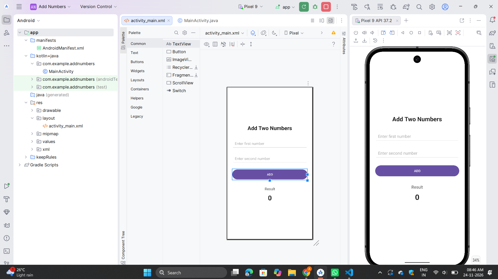
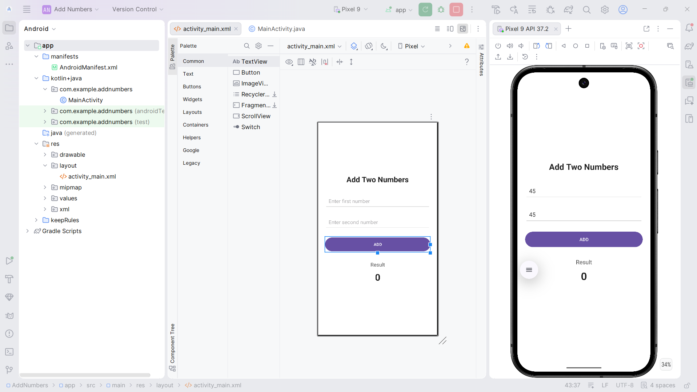
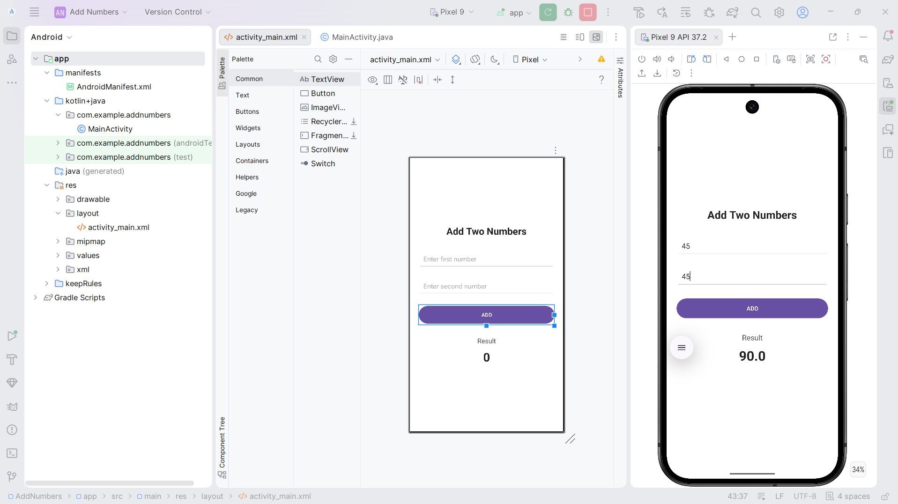

## WORKSHOP to ADD TWO NUMBERS
# Addnumbers
## Aim:
To create and design an android application to add two numbers using android studio.

## EQUIPMENTS REQUIRED:
Android Studio(Latest Version)

## ALGORITHM:
Step 1: Open Android Stdio and then click on File -> New -> New project.

Step 2: Then type the Application name as smsintent and click Next.

Step 3: Then select the Minimum SDK as shown below and click Next.

Step 4: Then select the Empty Activity and click Next. Finally click Finish.

Step 5: Design layout in activity_main.xml.

Step 6:Display details give in MainActivity file.

Step 7: Save and run the application.

## PROGRAM:
Program to create and design an android application to add two numbers using Intent.
```
Program
Developed by : Aniruth S
Register No  : 212225040020
```
**MainActivity.java**
```java
package com.example.addnumbers;

import android.os.Bundle;
import android.widget.Button;
import android.widget.EditText;
import android.widget.TextView;
import android.widget.Toast;

import androidx.appcompat.app.AppCompatActivity;

import com.example.addnumbers.R;

public class MainActivity extends AppCompatActivity {

    EditText num1, num2;
    Button addBtn;
    TextView resultText;

    @Override
    protected void onCreate(Bundle savedInstanceState) {
        super.onCreate(savedInstanceState);
        setContentView(R.layout.activity_main);

        num1 = findViewById(R.id.num1);
        num2 = findViewById(R.id.num2);
        addBtn = findViewById(R.id.addBtn);
        resultText = findViewById(R.id.resultText);

        addBtn.setOnClickListener(v -> {

            String a = num1.getText().toString().trim();
            String b = num2.getText().toString().trim();

            if (a.isEmpty() || b.isEmpty()) {
                Toast.makeText(this, "Enter both numbers",
                        Toast.LENGTH_SHORT).show();
                return;
            }

            double n1 = Double.parseDouble(a);
            double n2 = Double.parseDouble(b);

            double sum = n1 + n2;

            resultText.setText(String.valueOf(sum));
        });
    }
}
```
**ActivityMain.xml**
```xml
<?xml version="1.0" encoding="utf-8"?>
<LinearLayout xmlns:android="http://schemas.android.com/apk/res/android"
    android:layout_width="match_parent"
    android:layout_height="match_parent"
    android:orientation="vertical"
    android:gravity="center"
    android:padding="24dp"
    android:background="#FFFFFF">

    <TextView
        android:layout_width="wrap_content"
        android:layout_height="wrap_content"
        android:text="Add Two Numbers"
        android:textSize="26sp"
        android:textStyle="bold"
        android:textColor="#222222"
        android:layout_marginBottom="30dp"/>

    <EditText
        android:id="@+id/num1"
        android:layout_width="match_parent"
        android:layout_height="55dp"
        android:hint="Enter first number"
        android:inputType="numberDecimal|numberSigned"
        android:padding="12dp"
        android:textColor="#222222"
        android:backgroundTint="#D6D6D6"/>

    <EditText
        android:id="@+id/num2"
        android:layout_width="match_parent"
        android:layout_height="55dp"
        android:hint="Enter second number"
        android:inputType="numberDecimal|numberSigned"
        android:padding="12dp"
        android:textColor="#222222"
        android:backgroundTint="#D6D6D6"
        android:layout_marginTop="18dp"/>

    <Button
        android:id="@+id/addBtn"
        android:layout_width="match_parent"
        android:layout_height="55dp"
        android:text="ADD"
        android:layout_marginTop="22dp"/>

    <TextView
        android:layout_width="wrap_content"
        android:layout_height="wrap_content"
        android:text="Result"
        android:textSize="18sp"
        android:textColor="#555555"
        android:layout_marginTop="30dp"/>

    <TextView
        android:id="@+id/resultText"
        android:layout_width="wrap_content"
        android:layout_height="wrap_content"
        android:text="0"
        android:textSize="32sp"
        android:textStyle="bold"
        android:textColor="#222222"
        android:layout_marginTop="10dp"/>

</LinearLayout>
```

## OUTPUT:







## RESULT:
Thus a Simple Android Application create a addition for two numbers using Android Studio is developed and executed successfully.
